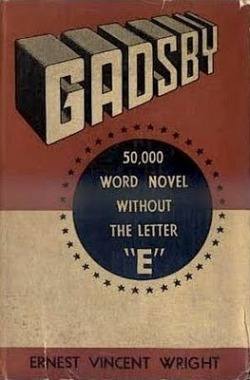

## Zad. 1
Utwórz skrypt `palindromes.py`, który wczyta plik [english_words.txt](../data/english_words.txt) i wyświetli na ekran wszystkie wyrazy które są palindromami składającymi się z co najmniej 5 liter.


## Zad. 2
Plik [Escherichia_coli.tsv](../data/Escherichia_coli.tsv) zawiera lokalizację genów bakterii *Escherichia coli*. Napisz program `ecoli.py`, który obliczy średnią, minimalną i maksymalną długość genu.

Wynik:

```
Min: 42
Avg: 949.8
Max: 7074
```


## Zad. 3


Powieść *"Gadsby"* autorstwa Ernesta Vincenta Wrighta to książka w której nie występuje litera *e* (najczęściej występująca litera w języku angielskim). W pliku [gadsby.txt](../data/gadsby.txt) znajduje się ta powieść. Napisz program `gadsby.py`, który sprawdzi, czy w książce rzeczywiście nie występuje litera *e*.

Wynik:

```
Letter e count: ?
```

## Zad. 4
Rozszerz kod programu `gadsby.py`, aby policzyć liczbę wszystkich słów znajdujących się w powieści *Gadsby*. W tym celu, wczytaj zawartość całej książki jako łańcuch znaków, usuń wszystkie wystąpienia znaków `. , ? ! ; : " ' - _ () * `. Następnie rozdziel łańcuch znaków na listę słów.

Wynik:

```
Letter e count     : ?
Words in total     : ?
```


## Zad. 5
Rozszerz kod programu `gadsby.py`, aby obliczyć liczbę wystąpień każdego słowa i zapisać wyniki do pliku `gadsby_words.txt`. Słowa powinny być uszeregowane alfabetycznie.

Zawartość pliku `gadsby_words.txt`:

```
count    word
?        a
?        abiding
?        abigail
?        ability
?        abnormality
?        abnormally
?        aboard
...
```


## Zad. 6
W pliku [lotto.txt](../data/lotto.txt) znajdują się wszystkie historyczne wyniki losowania Dużego Lotka od 27.01.1957 do 17.11.2026. Napisz program `lotto.py`, który dla każdej liczby od 1 do 49 obliczy, w jakim procencie losowań została ona wylosowana.

Wynik:

```
1   ?%
2   ?%
3   ?%
...
47  ?%
48  ?%
49  ?%
```


## Zad. 7. (dla chętnych)
Dwa wyrazy są anagramami, jeżeli można otrzymać jeden z drugiego przez przestawienie wszystkich liter, np. `silent` i `listen`.

Napisz program `anagrams.py`, który w pliku [english_words.txt](../data/english_words.txt) znajdzie grupy wyrazów będących anagramami. Uwzględnij wyrazy składające się z co najmniej 5 liter. Zapisz każdą grupę (zawierającą co najmniej dwa różne wyrazy) w osobnym wierszu w pliku wynikowym `anagrams.txt`.

Przykładowa zawartość pliku `anagrams.txt`:

```
enlist inlets listen silent slinte tinsel
...
```